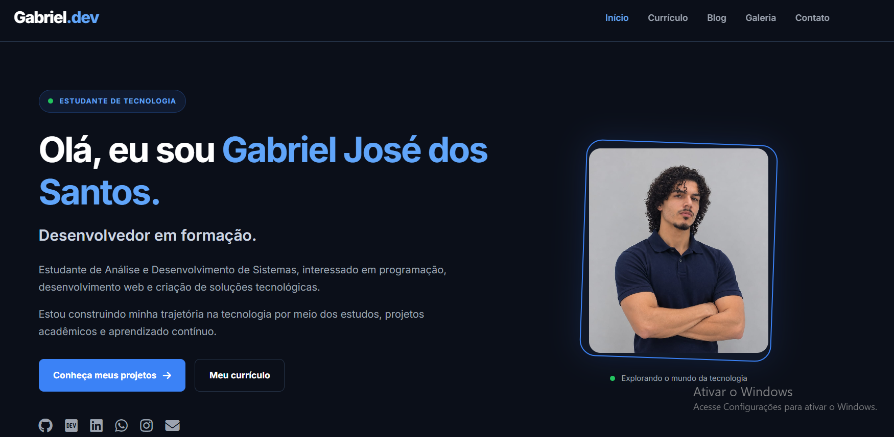
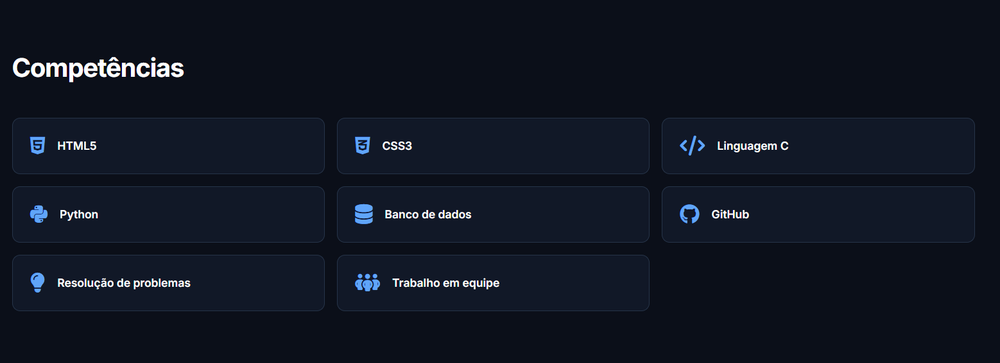

# Gabriel.dev | Portfólio Pessoal

<p align="center">
  <strong>GABRIEL JOSÉ DOS SANTOS</strong><br>
  Estudante de Análise e Desenvolvimento de Sistemas<br>
  Desenvolvedor em formação
</p>

<p align="center">
  <a href="https://github.com/gabrieljdsantos">GitHub</a> •
  <a href="https://www.linkedin.com/in/gabrieljdsantos">LinkedIn</a> •
  <a href="https://dev.to/gabriel_jdsantos">Dev.to</a>
</p>

---

## 01. Sobre o projeto

O **Gabriel.dev** é meu portfólio pessoal, desenvolvido como parte da minha jornada acadêmica no curso de Análise e Desenvolvimento de Sistemas (ADS).

O projeto tem como objetivo apresentar minha trajetória, competências, conhecimentos técnicos e projetos desenvolvidos durante meu processo de aprendizado na área de tecnologia.

A interface foi desenvolvida com HTML5 e CSS3, seguindo uma proposta visual moderna, minimalista e responsiva.

---

## 02. Demonstração visual

### Página inicial

Apresentação pessoal, identidade visual e acesso às principais áreas do portfólio.

<p align="center">
  
</p>

### Competências

Apresentação das tecnologias e habilidades desenvolvidas durante minha formação.

<p align="center">
  
</p>

### Projetos

<!-- INSIRA A IMAGEM DA SEÇÃO DE PROJETOS AQUI -->

<p align="center">
  
</p>

### Currículo

<!-- INSIRA A IMAGEM DA PÁGINA DE CURRÍCULO AQUI -->

<p align="center">
  
</p>

### Contato

<!-- INSIRA A IMAGEM DA PÁGINA DE CONTATO AQUI -->

<p align="center">
  
</p>

---

## 03. Tecnologias utilizadas

<p align="center">
  
  
</p>

**Ferramentas de desenvolvimento:**

- Visual Studio Code
- Live Server
- Git
- GitHub

---

## 04. Competências desenvolvidas

| Área | Conhecimentos |
|---|---|
| Desenvolvimento Web | HTML5 e CSS3 |
| Programação | Linguagem C e Python |
| Banco de Dados | Fundamentos de SQL |
| Versionamento | Git e GitHub |
| Layout | Flexbox e CSS Grid |
| Responsividade | Media Queries |
| Habilidades | Resolução de problemas e trabalho em equipe |

---

## 05. Funcionalidades

- Apresentação pessoal.
- Menu de navegação entre páginas.
- Currículo online.
- Página de blog.
- Galeria de imagens.
- Formulário de contato.
- Apresentação de projetos.
- Links para redes profissionais.
- Layout responsivo.
- Identidade visual padronizada.

---

## 06. Projetos desenvolvidos

### 1. Sistema de Controle de Estoque — C

Aplicação acadêmica desenvolvida em grupo para gerenciamento de produtos.

**Funcionalidades:**
- Cadastro de produtos.
- Consulta de informações.
- Alteração e exclusão de registros.
- Organização e ordenação.
- Controle de estoque.

**Tecnologia:** Linguagem C.

### 2. Sistema de Notas do Aluno — Python

Aplicação desenvolvida para receber duas notas, calcular a média final e informar a situação do aluno.

**Tecnologia:** Python.

### 3. Currículo Online — Jane Doe

Projeto acadêmico para aplicação dos conceitos de estruturação e estilização de páginas web.

**Tecnologias:** HTML5, CSS3, Google Fonts e Font Awesome.

### 4. Portfólio Pessoal — Gabriel.dev

Projeto desenvolvido para apresentar minha trajetória, competências e projetos na área de tecnologia.

**Tecnologias:** HTML5 e CSS3.

---

## 07. Estrutura do projeto

```text
pratica-html-css/
│
├── index.html
├── curriculo.html
├── blog.html
├── fotos.html
├── contato.html
├── style.css
│
├── imagens/
│   ├── foto-perfil.jpeg
│   ├── imagem1.jpg
│   ├── imagem2.png
│   ├── portfolio-inicio.png
│   ├── portfolio-competencias.png
│   ├── portfolio-projetos.png
│   ├── portfolio-curriculo.png
│   └── portfolio-contato.png
│
└── README.md
```

---

## 08. Como executar

1. Clone este repositório.
2. Abra a pasta no Visual Studio Code.
3. Localize o arquivo `index.html`.
4. Clique com o botão direito.
5. Selecione **Open with Live Server**.

Também é possível abrir o arquivo `index.html` diretamente no navegador.

---

## 09. Objetivo profissional

Sou estudante de Análise e Desenvolvimento de Sistemas e estou construindo minha trajetória na área de tecnologia por meio dos estudos, da prática e do desenvolvimento de projetos.

Tenho interesse em programação, desenvolvimento web, banco de dados e criação de soluções tecnológicas.

Meu objetivo é continuar aprimorando minhas habilidades, adquirir experiência prática e evoluir profissionalmente na área de desenvolvimento de software.

---

## 10. Contato

**Gabriel José dos Santos**

- **E-mail:** gabriel.santos.gjs@outlook.com
- **LinkedIn:** [Meu perfil](https://www.linkedin.com/in/gabrieljdsantos)
- **GitHub:** [Meus repositórios](https://github.com/gabrieljdsantos)
- **Dev.to:** [Meu perfil](https://dev.to/gabriel_jdsantos)
- **Instagram:** [@gabriel_jdsantoss](https://www.instagram.com/gabriel_jdsantoss/)

---

<p align="center">
  <strong>GABRIEL.DEV</strong><br>
  Construindo conhecimento. Desenvolvendo soluções. Evoluindo sempre.
</p>
